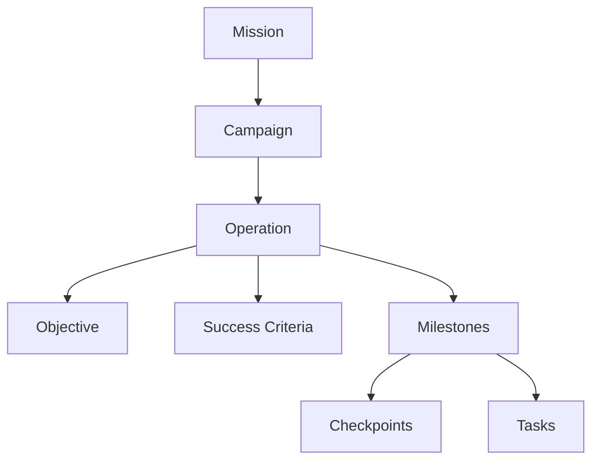
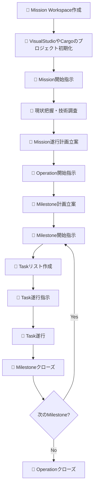
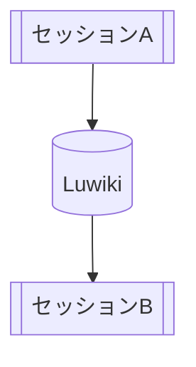
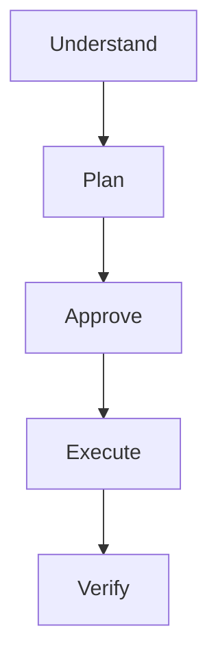

# Luwiki エンジニアリングハーネス

AIエージェントによるソフトウェア開発を、長期間・複数セッションにわたって一貫した方針で進めるための **engineering harness** です。

このリポジトリでは、AIエージェントに単発の指示を与えるだけではなく、プロジェクトの目的、計画構造、作業規範、タスク、セッション間の状態などを Wiki 上に明示的に保持し、人間とAIエージェントが協調して開発を進めるための環境を提供します。

> [!NOTE]
> This project is currently under development.
> Documents, directory structure, terminology, and workflows may change as the harness evolves.

## 概要

LLMベースのAIエージェントをソフトウェア開発に利用する場合、単一のセッションだけで完結しない作業では、次のような問題が発生します。

- コンテキストウィンドウの制約により過去の判断や作業状態が失われる
- セッションごとに作業方針や判断基準が変化する
- 大きな目的と現在実行しているタスクとの関係が不明瞭になる
- エージェントが必要以上に自律的に判断し、人間の意図から逸脱する
- 調査、計画、実装、レビューなどの過程が会話履歴だけに埋没する
- 複数のエージェントやサブエージェントを利用した際にコンテキストの整合性を維持しにくい

このハーネスでは、これらを会話履歴だけで解決しようとするのではなくプロジェクトの状態を外部化されたWikiドキュメントとして管理することで解決することを目指しています。

AIエージェントはWiki上の規範、計画、タスクリスト、作業記録などを参照しながら作業し、人間は重要な計画や意思決定に対する監督者として関与します。

## 目標

このプロジェクトでは、主に次のことを目標としています。

- AIエージェントによる長期間のソフトウェア開発を支援する
- セッションをまたいでも作業状態と判断根拠を維持できるようにする
- 「目的 → 計画 → 中間状態 → タスク」の関係を明示する
- AIエージェントの作業方法を共通規範・ガイドラインとして管理する
- 人間が重要な計画・判断・変更を監督できる状態を維持する
- エージェントが必要な情報だけを取得し、コンテキストを効率的に利用できるようにする
- 複数エージェント／サブエージェントを利用する場合の作業分担を体系化する
- 特定のLLMやエージェント実装に過度に依存しない運用モデルを構築する

## 基本概念

### エージェントの状態を外部化するWiki

このハーネスでは、WikiをAIエージェントの外部状態ストアとして利用します。

会話履歴だけに依存せず、以下の情報をWiki上に保持します。

- プロジェクトの目的
- 作業スコープ
- 開発規範
- ガイドライン
- Missionの遂行計画
- Milestone
- Taskリスト
- 調査結果
- 設計判断
- 作業記録
- セッション間の申し送り

これにより、エージェントのコンテキストがリセットされた場合でも、必要な情報を再取得して作業を継続できます。

---

### 階層的な計画

プロジェクトの計画は次の階層で管理します。



#### ミッション

プロジェクト全体の大目的です。

「なぜこのプロジェクトを行うのか」「最終的に何を達成するのか」を定義します。

#### キャンペーン

Missionを前進させるための大規模な戦略的取り組みです。

複数のOperationをまとめる必要がある、大規模または複雑なMissionで使用します。

#### オペレーション

具体的なObjectiveを達成するための主要な実行単位です。

Operationには原則として以下を定義します。

- Objective
- Success Criteria
- Milestones
- Checkpoints

#### マイルストーン

Operationの途中で到達すべき**中間状態**です。

Milestoneは「何をするか」ではなく、「何が成立している状態になるか」として記述します。

#### チェックポイント

計画を継続・修正・停止するか判断するレビューまたは意思決定地点です。

#### タスク

Milestoneを達成するために実行する、具体的な最小作業単位です。

---

## 人間による監督と承認

このハーネスでは、AIエージェントを完全自律的な開発主体として扱いません。

プロジェクトに関する最終的な決定権と責任はユーザが保持します。

特に以下のような境界では、人間による確認・承認を前提とします。

- Missionの設定
- Mission遂行計画
- Operation / Milestone計画
- 重要な設計判断
- 作業範囲の変更
- Milestoneの完了判定
- Operationの完了判定
- リポジトリへのコミット

AIエージェントは計画・調査・実装・検証を支援しますが、プロジェクトの意思決定主体はあくまでユーザです。

## 標準的な作業フロー

基本的な開発フローは次のようになります。



### 1. ミッションワークスペースの作成

ユーザがMissionのワークスペースを作成します。

ここには例えば次の情報を記述します。

- 目的
- ゴール
- 背景
- スコープ
- 利用可能なリソース
- 遵守する共通規範
- ガイドライン
- 制約・禁止事項

Mission Workspaceは、そのMissionを遂行する際の基準点になります。

### 2. ミッションの開始

Mission開始時、エージェントはまず既存の情報を読み込みます。

主な作業は次のとおりです。

- Mission Workspaceの確認
- 関連文書の確認
- プロジェクト構造の把握
- ソースコードの初期調査
- 必要な技術調査
- 不明点・リスクの抽出

いきなり実装を開始するのではなく、まず現在の状態を理解します。

### 3. 計画の作成

初期調査をもとにMission遂行計画を作成します。

大規模なMissionでは、

```text
Mission
└── Campaign
    └── Operation
        ├── Objective
        ├── Success Criteria
        └── Milestones
```

という形で段階的に分解します。

### 4. マイルストーンの遂行

Milestone開始時には、そのMilestoneを達成するためのTaskリストを作成します。

Taskリストには次の情報を含めます。

- 目的
- 受け入れ基準
- 前提条件
- 参照情報
- 事前確認事項
- Task
- 補足事項

Taskはチェックリストとして管理し、完了状態を逐次更新します。

作業記録はタスクグループ単位でタスクリスト配下の独立したページにまとめます。作成した記録へのリンクは、ミッションワークスペースの索引の当該タスクリスト配下と、タスクリストの当該タスクグループ末尾に設ける「成果物」欄に登録します。

### 5. レビューと完了判定

Milestone終了時には「Taskを全部実行したか」だけではなく、Milestoneで定義された**達成状態が成立したか**を確認します。

Operation終了時には、あらかじめ定義されたSuccess Criteriaに基づいてObjectiveの達成状態を評価します。

## セッション間の申し送り

LLMのコンテキスト制限などによってセッションを切り替える場合、現在の状態をWikiに保存します。

申し送りには原則として次の情報を含めます。

- **Current status** — 現在の進捗、完了事項、未完了事項
- **Current strategy** — 実装方針、設計判断、テスト方針
- **Next actions** — 次に実施すべき作業
- **Open issues** — 未解決事項、保留事項、判断待ち
- **References** — 関連Wikiページ、ソースコード、設計資料
- **Additional notes** — 次セッションで失われると困る情報

次のセッションでは、この申し送りを読み込むことで作業状態を復元します。



これにより、セッションそのものを永続化するのではなく、**作業を再開するために必要な状態を永続化する**ことを狙っています。

## 共通規範とガイドライン

ハーネス内のルールは、大きく **共通規範 (Constitutions)** と **ガイドライン (Guidelines)** に分けています。

### 共通規範

原則として常に遵守すべきルールです。

現在、以下のような規範を定義しています。

- プロジェクト構造仕様
- プロジェクト運営指針
- タスクリスト記述仕様
- タスクリスト運用方法
- [作業強度設定指針](root/ワークエリア/共通規範/作業強度設定指針.md)
- [質問書記述仕様](root/ワークエリア/共通規範/質問書記述仕様.md)
- [議論に関する指針](root/ワークエリア/共通規範/議論に関する指針.md)
- [その他の附則](root/ワークエリア/共通規範/その他の附則.md)

作業強度設定指針では、タスクまたは成果物ごとに作業強度を「軽量」「標準」「高強度」に分類し、計画・実装・検証にかけるコストを調整します。明示された設定を優先し、明確な理由がない限り「軽量」または「標準」とします。選択した作業強度において目的を満たした時点で作業を終了し、目的達成に不要な作業は追加しません。

質問書記述仕様では、不明点をユーザに問い合わせる質問書の構成と運用を定めています。質問書への直接記入またはプロンプトによる回答を受け付け、回答の整合性と目的の達成を確認します。

議論に関する指針では、問題をテーマに分解したテーマシートを用いて議論を進めます。ユーザの決定権に属する結論は承認をもって確定し、結論と経緯を記録して以後の作業に反映します。

その他の附則では、文書をリポジトリ内で理解・利用できる状態に保つこと、推測・仮定・未確認情報を明示すること、既存の決定事項や作業範囲を独断で変更しないこと、関連成果物との整合性を確認すること、作業・検証の実施状況を正確に報告することなどを定めています。

### ガイドライン

特定の作業を行う際に適用する実践的なルールです。

現在、以下のようなガイドラインを含みます。

- ソースコード検索・解析
- セッション切り替え時の申し送り
- サブエージェント利用

## コンテキストの利用効率

AIエージェントにリポジトリ全体を無差別に読み込ませることは、コンテキストの利用効率を低下させます。

そのため、本ハーネスではコード調査において、

1. コードインデックスによる探索
2. テキスト検索による補助
3. 必要なソースコードだけを取得

という段階的な調査を推奨しています。

現在のガイドラインでは、用途に応じて以下のツールを利用することを想定しています。

- `scip-cli`
- `ast-index`
- `ripgrep` (`rg`)

例えば、意味的なシンボル参照が必要な場合にはSCIPを優先し、動的言語や構造探索ではASTベースのインデックスを利用する、といった使い分けを行います。

## サブエージェント

サブエージェントを利用できる環境では、独立して実行可能な調査・分析・実装・レビューなどを委譲できます。

ただし、単に並列化すること自体を目的とはしません。

主な目的は次のとおりです。

- メインコンテキスト消費の抑制
- コンテキストの局所化
- 同じ情報を何度も取得することの削減
- 安全に独立できる作業の並列化

メインエージェントは引き続き、

- 全体計画
- ユーザとの合意形成
- 委譲範囲の決定
- 依存関係の管理
- 成果の統合
- 最終判断

を担当します。

## リソース類

ハーネスには、エージェントとの作業を開始・継続するための再利用可能なリソースも含まれます。

### プロンプト

現在、以下のプロンプトを用意しています。

- Mission開始
- Milestone開始
- セッション切り替え
- セッション再開

一部のプロンプトにはMCP Prompt Primitiveとして利用するためのメタデータが含まれています。

### テンプレート

現在、以下のWikiページテンプレートを用意しています。

- Project Workspace
- Mission Workspace

テンプレートを利用することで、Missionごとの基本構造を統一できます。

## リポジトリ構造

現在のハーネスは概ね次の構造になっています。

```text
root/
├── ワークエリア.md
├── ワークエリア/
│   ├── 共通規範.md
│   ├── 共通規範/
│   │   ├── プロジェクト構造仕様.md
│   │   ├── プロジェクト運営指針.md
│   │   ├── タスクリスト記述仕様.md
│   │   ├── タスクリスト運用方法.md
│   │   ├── 作業強度設定指針.md
│   │   ├── 質問書記述仕様.md
│   │   ├── 議論に関する指針.md
│   │   └── その他の附則.md
│   │
│   ├── ガイドライン.md
│   └── ガイドライン/
│       ├── ソース検索・解析ガイドライン.md
│       ├── セッション申し送り作製ガイドライン.md
│       └── サブエージェント使用ガイドライン.md
│
├── リソース類.md
└── リソース類/
    ├── プロジェクトワークスペースひな形.md
    ├── ミッションワークスペースひな型.md
    ├── ミッション開始.md
    ├── マイルストーン開始.md
    ├── セッション切替え.md
    └── セッション再開.md
```

> Directory structure is subject to change while the project is under development.

## 利用要件

このハーネスは、WikiをAIエージェントから読み書きできる環境で利用することを想定しています。

具体的な実行環境や必須コンポーネントについては、今後整理する予定です。

現状では少なくとも次の能力を持つエージェント環境を想定しています。

- Wikiページの読み込み
- Wikiページの作成・更新
- プロジェクトファイルの読み込み
- ソースコードの検索
- 必要に応じた外部ツールの実行

## 利用方法

> [!WARNING]
> Usage procedure is still being designed and may change.

基本的な利用イメージは次のとおりです。

### 1. ハーネスをWikiへ配置する

共通規範、ガイドライン、リソース類を利用するWikiへ配置します。

### 2. プロジェクトワークスペースを作成する

`プロジェクトワークスペースひな形` を使用して対象プロジェクト用のWorkspaceを作成します。

### 3. ミッションワークスペースを作成する

実施したいMissionごとに `ミッションワークスペースひな型` からWorkspaceを作成します。

Missionの目的、スコープ、ゴール、リソース等を設定します。

### 4. AIエージェントにミッションを開始させる

`ミッション開始` プロンプトを使用してMission WorkspaceをAIエージェントへ提示します。

エージェントはMissionの内容と関連情報を読み込み、初期調査から作業を開始します。

## 設計方針

### 会話は一時的に扱い、状態は永続化する

会話は一時的な実行コンテキストとして扱い、長期的に必要な情報はWikiへ残します。

### 実行前に計画する

大規模な変更をいきなり実行するのではなく、



というサイクルを基本とします。

### 作業内容に加えて達成状態を記述する

MilestoneやSuccess Criteriaでは「何をするか」ではなく、「何が成立すれば完了なのか」を重視します。

### 人間が決定権を保持する

AIエージェントは強力な実行主体になり得ますが、プロジェクトの最終的な意思決定主体ではありません。

### 必要な情報だけを読み込む

すべてをコンテキストへ読み込むのではなく、Wiki、コードインデックス、検索ツールなどを利用して、現在の作業に必要な情報だけを段階的に取得します。

## プロジェクトの状況

🚧 **Experimental / Work in Progress**

現在はハーネス自体の設計・検証を行っている段階です。

特に以下については今後変更される可能性があります。

- 用語
- Wiki構造
- Mission / Operation / Milestoneの運用方法
- MCP integration
- Prompt definitions
- Template definitions
- Agent guidelines

実際のAIエージェント開発で運用しながら、規範・ガイドライン・テンプレートを更新していく予定です。

## ライセンス

MIT License.

See [LICENSE](LICENSE) for details.
