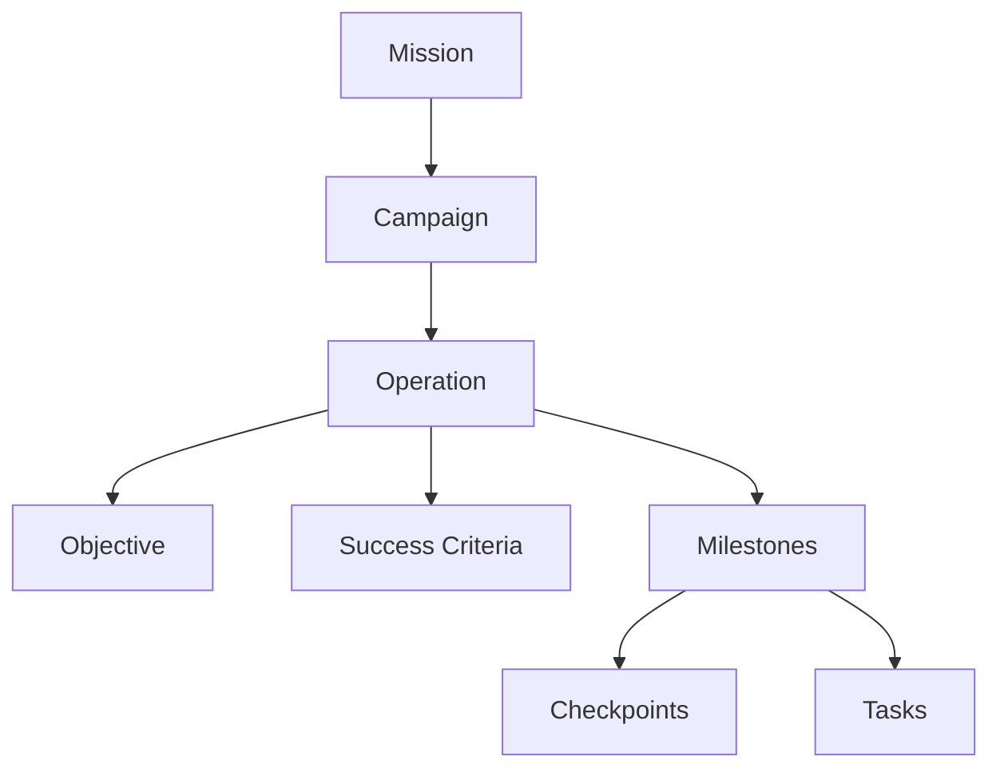

# プロジェクト構造仕様

## 目的

この文書は、エージェントが大目的を実行可能な作業へ分解するための標準的な計画構造を定義する。

エージェントは、計画作成、計画修正、進捗評価、実行報告を行う際に、この構造を参照しなければならない。

## 基本階層

プロジェクト構造は、次の階層として解釈する。



## 用語定義

### Mission

Mission は、プロジェクト全体の大目的、または解決すべき上位問題である。

Mission は、計画全体の判断基準として安定的に保持されるべきものであり、局所的な問題に反応して場当たり的に追加・変更・連結してはならない。

Mission は次の問いに答える。

* このプロジェクトはなぜ存在するのか
* 最終的にどの大目的を達成するのか
* 下位の計画判断を導く基準は何か

### Campaign

Campaign は、Mission を前進させるための大規模な戦略的取り組みである。

Campaign は、共通する戦略的方向性を持つ複数の Operation を束ねる。

Campaign は次の問いに答える。

* Mission をどの方面から前進させるのか
* どの大きな取り組みを統合して管理するのか
* どの Operation 群を同じまとまりとして扱うのか

単一の Operation では表現しきれない大規模または複雑な作業がある場合に Campaign を使用する。

### Operation

Operation は、Campaign の中で特定の Objective を達成するために設計された構造化された活動群である。

Operation は、計画における主要な実行単位である。

Operation は次の問いに答える。

* どの具体的な作業群を実行するのか
* その作業群によって何を達成するのか
* どの Milestone と Task が必要か

各 Operation は、必ず明確な Objective と Success Criteria を持たなければならない。

### Objective

Objective は、各 Operation に割り当てられる具体的な目標である。

Objective は、その Operation が何を達成するためのものかを定義する。Mission や Campaign より具体的であり、Milestone や Task を分解する基準になる。

Objective は次の問いに答える。

* この Operation は何を達成するのか
* Operation 完了時にどの状態または成果が存在すべきか
* この Operation の主目的は何か

Objective は、単なる作業内容ではなく、達成したい結果として記述する。

### Success Criteria

Success Criteria は、Operation が成功したと判断するために満たすべき条件である。

Success Criteria は Checkpoint ではない。Success Criteria は、Objective が達成されたかどうかを判定するための基準である。

Success Criteria は次の問いに答える。

* Operation が成功したとどう判断するのか
* どの観測可能な条件が満たされる必要があるのか
* どの成果物、証拠、判断、指標が必要か

Success Criteria は、具体的で検証可能であり、Objective と直接対応していなければならない。

### Milestone

Milestone は、Operation の途中で到達すべき中間状態である。

Milestone は単なる作業ではない。進捗上意味のある達成状態として記述する。

Milestone は次の問いに答える。

* 途中でどの状態に到達している必要があるのか
* Operation が前進していると判断できる中間状態は何か
* 後続作業に進む前に何が成立している必要があるのか

Milestone は、作業行為ではなく、達成済みの状態として記述する。

### Checkpoint

Checkpoint は、Operation の途中に設けるレビューまたは意思決定の地点である。

Checkpoint は、進捗確認、仮説検証、成果物確認、継続・修正・停止の判断を行うタイミングを定義する。

Checkpoint は次の問いに答える。

* いつ進捗を確認するのか
* その時点で何を確認するのか
* 計画を継続、修正、停止、または上位判断へ移すべきか

Checkpoint では、Success Criteria、Milestone、制約、リスク、外部フィードバックなどを評価材料として使用できる。

### Task

Task は、具体的に実行可能な行動である。

Task は計画構造の最小実行単位であり、エージェントが実行または委任できる程度に具体的でなければならない。

Task は次の問いに答える。

* 何を実行するのか
* どの成果物または状態を作るのか
* どの情報、ツール、リソースが必要か

Task は明確で、範囲が限定され、Milestone または Objective に直接接続していなければならない。

## 計画作成ルール

エージェントは計画を作成する際、次のルールに従う。

1. Mission から開始する。
2. 作業が大規模または複数方面に分かれる場合、Campaign を定義する。
3. 各 Campaign に対して Operation を定義する。
4. 各 Operation には、原則として1つの主要 Objective を定義する。
5. Milestone を生成する前に、Objective と Success Criteria を定義する。
6. Milestone は作業行為ではなく、一連のTaskの結果達成される中間的な状態として定義する。
7. Checkpoint は成功条件ではなく、レビューまたは意思決定の地点として定義する。
8. Task は、Objective、Success Criteria、Milestone が明確になってから生成する。
9. 局所的な問題に対応するために、新しい Mission を場当たり的に作成してはならない。
10. 想定外の問題が発生した場合は、Mission を変更する前に、Campaign、Operation、Milestone、Checkpoint、Task の修正を検討する。

## 出力形式

エージェントが計画を作成または修正する場合、原則として次の形式を使用する。

```text
Mission:
- <大目的>

Campaigns:
- Campaign: <campaign名>
  Purpose:
  - <このcampaignが存在する理由>

  Operations:
  - Operation: <operation名>
    Objective:
    - <このoperationの具体的な目標>

    Success Criteria:
    - <検証可能な成功条件>
    - <検証可能な成功条件>

    Milestones:
      - <中間的な達成状態>
      - <中間的な達成状態>

    Checkpoints:
    - <レビューまたは意思決定の地点>
    - <レビューまたは意思決定の地点>
    
    - Tasks:
      Task:
      - <具体的に実行可能な行動>
```

## 品質要件

エージェントは、次の整合性を満たすように計画を作成する。

* すべての Task は Milestone または Objective に貢献している。
* すべての Milestone は Operation Objective に貢献している。
* すべての Operation Objective は Campaign に貢献している。
* すべての Campaign は Mission を前進させている。
* Success Criteria は検証可能である。
* Milestone は達成状態として記述されている。
* Task は実行可能な行動として記述されている。
* Checkpoint はレビューまたは意思決定の地点として記述されている。
* Mission は、全体目的が変わらない限り安定的に保持されている。

## 避けるべきパターン

### Mission の連結

局所的な問題に対応するために、小さな Mission を連続的に作成してはならない。

不適切な例:

```text
Mission:
LPを改善する。

Mission:
登録フォームを改善する。

Mission:
アクティベーションメールを改善する。
```

適切な例:

```text
Mission:
新規ユーザーの獲得と初期活性化を改善する。

Campaign:
コンバージョン改善キャンペーン

Operations:
- LP最適化
- 登録フロー改善
- アクティベーションメール改善
```

### 作業ベースの Milestone

Milestone を単なる作業行為として定義してはならない。

不適切な例:

```text
Milestone:
ユーザーインタビューを行う。
```

適切な例:

```text
Milestone:
ユーザーインタビューから主要な課題が特定されている。
```

### 曖昧な Success Criteria

Success Criteria を主観的または曖昧にしてはならない。

不適切な例:

```text
Success Criteria:
よい結果になっている。
```

適切な例:

```text
Success Criteria:
少なくとも3つの候補案が、コスト、実現可能性、期待インパクトの観点で比較されている。
```

### Task 先行の計画

Objective と Success Criteria が明確になる前に Task を生成してはならない。

不適切な例:

```text
Tasks:
- コピーを書く
- 表を作る
- ユーザーを分析する
```

適切な例:

```text
Objective:
有望なユーザー獲得チャネルを2つ特定する。

Success Criteria:
- 3つ以上のチャネルが同一基準で比較されている。
- 獲得単価、登録率、継続利用の兆候が考慮されている。
- 継続検証すべきチャネルが2つ選定されている。

Tasks:
- 候補となる獲得チャネルを列挙する。
- 各チャネルの利用可能な実績データを収集する。
- 評価基準に基づいてチャネルを比較する。
- 継続検証する2つのチャネルを選定する。
```

## 計画修正時の挙動

エージェントは、計画が失敗している、曖昧である、または不完全であると判断した場合、どの階層を修正すべきかを特定する。

* 大目的が誤っている場合は Mission を修正する。
* 戦略的方向性が誤っている場合は Campaign を修正する。
* 実行単位が誤っている場合は Operation を修正する。
* Operation の目標が曖昧な場合は Objective を修正する。
* 成功判定ができない場合は Success Criteria を修正する。
* 中間到達状態が不足している場合は Milestone を修正する。
* レビューや意思決定の地点が不足している場合は Checkpoint を修正する。
* 実行行動が曖昧な場合は Task を修正する。

エージェントは、Mission との整合性を回復できる最小の修正を優先する。

